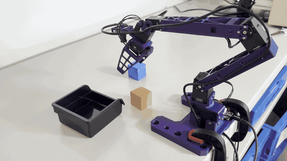

# openjev-cube-pick

ROBOTIS の OMX-F（OMX-AI キットのフォロワーアーム）に声で指示して、机の上の物をつかみ、容器に入れます。
「ジョニー、赤いキューブをトレイに入れて」と話しかけると、音声エージェント **Johnny** が指示を理解して実行し、結果を答えます。



- **指示の理解**: マイクの音声をローカルの文字起こしサーバーでテキストにし、gpt-5.5 が会話の流れを踏まえて「どれをつかんで、どこに置くか」のタスク列にします。あいまいなときは聞き返します。
- **大まかな移動**: 俯瞰カメラの画像に gpt-5.5 が物体・容器・グリッパーの点を付け、アームを対象の上まで動かします。カメラの較正ファイルやマーカーは使いません。起動時にアームが数か所を回り（約 40 秒）、各姿勢のグリッパーの位置から画像の縮尺をその場で求めます。セッションをまたいで保存するものはありません。
- **位置合わせと把持**: 手首カメラの画像で、グリッパー真下に当たる点に緑の十字を描きます。判断層（[openjev](https://github.com/razorback16/openjev)、ローカル GPU で動く TypeSafe Jev 互換サーバー）に「対象は十字の左か右か」「上か下か」を聞きながら近づき、真下に降りてつかみます。
- **確認**: 置いたあと、俯瞰画像で容器に入ったかを確かめてから報告します。

判断層に物体の座標を渡すことはありません。動作は MuJoCo のデジタルツイン上で IK を解き、関節目標を ROS 2 で送ります。

> このリポジトリはロボットアームを実際に動かします。先に「[7. 安全](#7-安全)」を読んでください。

---

## 目次

1. [必要なもの](#1-必要なもの)
2. [ゼロからのセットアップ（初回だけ）](#2-ゼロからのセットアップ初回だけ)
3. [Johnny を起動して使う](#3-johnny-を起動して使う)
4. [毎日の起動と終了](#4-毎日の起動と終了)
5. [自分のリグに合わせる値](#5-自分のリグに合わせる値)
6. [困ったとき](#6-困ったとき)
7. [安全](#7-安全)
8. [リポジトリの構成・テスト・ライセンス](#8-リポジトリの構成テストライセンス)

---

## 1. 必要なもの

| | |
|---|---|
| ロボット | ROBOTIS OMX-AI キット: **OMX-F**（フォロワー、つかむ側）と **OMX-L**（リーダー、テレオペ用。なくてもピック＆プレースは動きます）。どちらも OpenRB-150 ボード経由で USB 接続し、`/dev/ttyACM*` として見えます |
| カメラ | USB カメラ 2 台: グリッパーに固定した**手首カメラ**と、机を真上から見下ろす**俯瞰カメラ**（作者のリグ: 手首 Innomaker U20CAM-720P、俯瞰 j5 WebCam JVU430） |
| マイク | OS の既定の入力（ALSA `default`）で録れるもの。作者のリグは俯瞰カメラ内蔵のマイク |
| 物体と容器 | グリッパーでつかめる小物（試したもの: 3 cm のキューブ、ぬいぐるみの人参、テープ）と、縁の高さ 4 cm ほどの容器（トレイ・箱）。名前は台の上を見て自動で付けるので、登録は不要です |
| PC | Ubuntu 24.04、NVIDIA GPU（VRAM 24 GB 以上。openjev 用）、RAM 64 GB 推奨、空きディスク 40 GB 以上 |
| ソフトウェア | ROS 2 Jazzy、Docker + NVIDIA Container Toolkit、Python 3.12（`python3-venv`）、`alsa-utils`（`arecord`） |
| ネットワーク | OpenAI API に常時つながること（指示の解釈と俯瞰画像のマーキング。従量課金）。不安定な Wi-Fi だと途中で失敗するので、デモでは有線 LAN を推奨 |
| API キー | OpenAI（必須） |

動作確認した環境: Ubuntu 24.04.3、RTX PRO 5000 Blackwell Laptop（24 GB）、NVIDIA ドライバ 580、ROS 2 Jazzy（ros2_control 4.48）。

---

## 2. ゼロからのセットアップ（初回だけ）

上から順に進めます。各ステップの最後に、うまくいったかを確かめる方法を書いています。

### 2.1 GPU ドライバと Docker

1. NVIDIA ドライバを入れます（Blackwell 世代は 570 系以降）。`nvidia-smi` に GPU と 24 GB が出れば OK です。
2. Docker と NVIDIA Container Toolkit を入れ、自分を `docker` グループに入れます。

   ```bash
   sudo apt install docker.io
   curl -fsSL https://nvidia.github.io/libnvidia-container/gpgkey | sudo gpg --dearmor -o /usr/share/keyrings/nvidia-container-toolkit-keyring.gpg
   curl -s -L https://nvidia.github.io/libnvidia-container/stable/deb/nvidia-container-toolkit.list | \
     sed 's#deb https://#deb [signed-by=/usr/share/keyrings/nvidia-container-toolkit-keyring.gpg] https://#g' | \
     sudo tee /etc/apt/sources.list.d/nvidia-container-toolkit.list
   sudo apt update && sudo apt install nvidia-container-toolkit
   sudo nvidia-ctk runtime configure --runtime=docker && sudo systemctl restart docker
   sudo usermod -aG docker $USER
   ```

3. その他のパッケージ:

   ```bash
   sudo apt install git curl python3-venv alsa-utils libegl1 libgl1 libosmesa6 python3-tk
   ```

ノート PC 固有の注意（VRAM の空け方、電源設定）は [docs/setup_laptop.md](docs/setup_laptop.md) にあります。

### 2.2 ROS 2 Jazzy と OMX のドライバ

1. ROS 2 Jazzy（`ros-jazzy-desktop`）を[公式手順](https://docs.ros.org/en/jazzy/Installation/Ubuntu-Install-Debs.html)で入れます。
2. ROBOTIS のパッケージをワークスペースに取得してビルドします。

   ```bash
   sudo apt install python3-colcon-common-extensions python3-rosdep
   sudo rosdep init 2>/dev/null; rosdep update
   mkdir -p ~/ros2_ws/src && cd ~/ros2_ws/src
   git clone https://github.com/ROBOTIS-GIT/open_manipulator.git
   git clone https://github.com/ROBOTIS-GIT/cyclo_control.git
   git clone https://github.com/ROBOTIS-GIT/robotis_interfaces.git
   mkdir -p utils && git clone https://github.com/ROBOTIS-GIT/dynamixel_hardware_interface.git utils/dynamixel_hardware_interface
   cd ~/ros2_ws
   source /opt/ros/jazzy/setup.bash
   rosdep install --from-paths src -y --ignore-src
   colcon build --symlink-install
   ```

   動作確認したコミット（いずれも `main`）: open_manipulator `0a4af6a`、cyclo_control `f94efd3`、robotis_interfaces `c79afb6`、dynamixel_hardware_interface `6bb5f93`。動かないときは `git checkout <コミット>` でそろえてください。

3. シリアルポートを使えるようにします（**再ログインが必要**）。

   ```bash
   sudo usermod -aG dialout $USER
   ```

確認: 再ログイン後に `groups` に `dialout` と `docker` が出て、`source ~/ros2_ws/install/setup.bash && ros2 pkg list | grep open_manipulator_bringup` が 1 行出れば OK です。

### 2.3 このリポジトリと Python 環境

`rclpy` は PyPI からは入らないので、ROS 2 の Python が見える仮想環境を作ります。

```bash
git clone -b johnny-voice-demo https://github.com/tamon0987/openjev-cube-pick.git
cd openjev-cube-pick

source /opt/ros/jazzy/setup.bash
source ~/ros2_ws/install/setup.bash
/usr/bin/python3 -m venv --system-site-packages .venv
source .venv/bin/activate
pip install -e ".[real,voice,dev]"

cp .env.example .env
# .env を開いて OPENAI_API_KEY= の後ろに自分のキーを書く（.env は git に入りません）
```

確認:

```bash
bash scripts/check_env.sh     # GPU / Docker / Python パッケージ / rclpy / 描画 / API キーを一覧で確認
MUJOCO_GL=egl PYOPENGL_PLATFORM=egl python -m pytest -q   # ロボットもネットワークも不要。全部 passed になる
```

`check_env.sh` で `MISSING` が出たら、その行のヒントに従ってください。

### 2.4 判断層 openjev を起動する（初回は 20〜30 分）

```bash
bash scripts/serve_openjev.sh
docker logs -f openjev        # 進み具合を見る（Ctrl+C でログ表示だけ止まる）
```

初回は重み（約 19 GB）を `~/.cache/huggingface` にダウンロードし、GPU カーネルをコンパイルするので 20〜30 分かかります。次回以降はキャッシュを使い、1〜2 分で立ち上がります。

確認: `curl -s localhost:8080/health` が返事をすれば OK です（`/health` が 200）。

一度コンテナができれば、以後は Johnny のセットアップが `docker start openjev` で起動します（オフラインで起動するので、初回のダウンロードだけはここで済ませておいてください）。詳しくは [docs/openjev.md](docs/openjev.md)。

### 2.5 文字起こしサーバーを起動する

```bash
bash scripts/stt_server.sh    # CPU で動く Whisper（speaches）。初回はモデル（約 1.6 GB）をダウンロード
```

`models/silero_vad.onnx`（発話区間の検出）もこのスクリプトが取得します。

確認: `curl -s localhost:8010/health` が返事をすれば OK です。コンテナは `--restart unless-stopped` なので、PC を再起動しても自動で立ち上がります。

### 2.6 ハードウェアをつなぐ

1. フォロワー（OMX-F）とリーダー（OMX-L）の電源を入れ、それぞれの USB を PC に挿します。
2. 手首カメラと俯瞰カメラを挿します。俯瞰カメラは机全体とロボットの根元が写る高さに固定します。
3. 認識されたかを確かめます。

   ```bash
   lsusb | grep -i -e robotis -e cam     # ROBOTIS OpenRB-150 が 2 行、カメラが 2 行
   ls -l /dev/serial/by-id/              # アーム 2 台が ttyACM* として見える
   ls /dev/v4l/by-id/ | grep index0      # カメラ（PC 内蔵カメラも並ぶことがあります）
   arecord -l                            # マイク
   ```

   アームが `lsusb` に出ないときは、ケーブル（充電専用でないか）、挿し込み、電源 LED を確認します。USB ハブを使う場合は電源付きのものを推奨します（電力不足で動作中に切れることがあります）。

どのポートがフォロワーか、どのカメラが手首か、俯瞰画像の向きは、次の Johnny のセットアップが対話で確かめて保存します（`results/johnny/rig.json` と `configs/robot/omx_f.yaml`）。手で設定を書く必要はありません。

---

## 3. Johnny を起動して使う

### 3.1 起動

新しいターミナルで、リポジトリのディレクトリから:

```bash
cd openjev-cube-pick
export ROS_DOMAIN_ID=42                # configs/robot/omx_f.yaml の ros_domain_id とそろえる
source /opt/ros/jazzy/setup.bash
source ~/ros2_ws/install/setup.bash
source .venv/bin/activate
python -m dlb.johnny --debug
```

`listening... (say the wake word first)` と出たら話しかけられます。

会話とログを別ウィンドウで見るには、もう 1 つのターミナルで:

```bash
.venv/bin/python scripts/johnny_monitor.py
```

「現在の音声・実行」タブに音声認識・依頼・返事・実行結果が、「会話履歴」タブに会話が流れます。見るだけで、ロボットには触りません。

### 3.2 セットアップ（「ジョニー、セットアップして」）

最初に必ずセットアップします。Johnny が次を順に行い、進み具合を話します。

1. **アームとカメラの特定**（新しい PC で最初の 1 回だけ）: 「フォロワーアームの USB だけを抜いてください」のように頼まれるので、言われたとおりに抜き差しして「抜きました」「挿しました」と答えます。カメラも同様に 1 台ずつ確かめ、俯瞰画像の向き（ロボットが画像の下に来る回転）を決めます。結果は保存され、次回からは聞かれません。
2. **サービスの起動**: フォロワーのドライバ（トルクが入り、アームはその場で保持）、openjev、文字起こしサーバーのうち、止まっているものを起動します。
3. **ロボットの起動と自己校正**: アームがはじめの姿勢に動き、周辺の 9 か所を回って俯瞰カメラの縮尺を求めます（約 40 秒）。**アームが動くので周りを空けてください。**
4. **待機位置へ**: 俯瞰カメラの視界を空けるため、手前上方の待機位置で止まります。台の上の物と容器を見て、名前を付けます。

「セットアップ完了です」と言われたら指示できます。

### 3.3 話しかけ方

- **毎回「ジョニー」（または「Hi, Johnny」）で始めます。** ウェイクワードのない発話は捨てられ、OpenAI には送られません。
- 一息で「ジョニー、緑のキューブをトレイに入れて」と言っても、「ジョニー」→「はい、どうぞ」→「緑のキューブをトレイに入れて」と分けても通ります。
- Johnny が聞き返したとき（「どちらですか？」）は、ウェイクワードなしで答えられます。
- 作業中に次の依頼をすると**割り込みます**。今の作業を止めて（今の移動が終わったところで止まります）、新しい依頼に移ります。「それが終わったら赤いキューブも入れて」「次に…」のように言うと、割り込まずに今の作業のあとで実行します。

| やりたいこと | 言い方の例 |
|---|---|
| つかんで容器に入れる | 「ジョニー、赤いキューブをトレイに入れて」「人参を箱に入れて」 |
| 物の上に積む | 「緑のキューブを赤いキューブの上に置いて」 |
| 状態を聞く | 「ジョニー、今の状態は？」「デモできそう？」 |
| リーダーで操作する（テレオペ） | 「ジョニー、テレオペして」→ 終えるとき「テレオペ止めて」 |
| すぐ止める | 「止まって」「ストップ」（**ウェイクワード不要**。アームはその場で保持） |
| 終わる | 「ジョニー、停止して」（グリッパーを開き、休止姿勢に戻ってからトルクを切る） |

1 回のピック＆プレースは 40〜60 秒ほどです。後から台に置いた物も、名前を言えば台を見直して見つけます。

### 3.4 終了

1. 「ジョニー、停止して」と言い、「停止しました」と返るのを待ちます（アームが休止姿勢でトルクオフ）。
2. Johnny のターミナルで Ctrl+C。

**アームにトルクが入ったまま Johnny を Ctrl+C で止めないでください。** ドライバも一緒に止まり、その場でトルクが切れてアームが落ちます。

---

## 4. 毎日の起動と終了

初回のセットアップが済んだ PC では、毎回これだけです。

1. アーム 2 台の電源を入れ、USB とカメラを挿す（`ls /dev/serial/by-id/` で 2 台見えるか確認）
2. ターミナルで [3.1](#31-起動) のコマンドを実行し、モニターも開く
3. 「ジョニー、セットアップして」（openjev が止まっていれば Johnny が起動します。最初の起動は 1〜2 分待つことがあります）
4. 指示する
5. 「ジョニー、停止して」→ Ctrl+C

USB の挿し直しや PC の再起動で `/dev/ttyACM*` や `/dev/video*` の番号が変わっても、USB の固有 ID で探すので問題ありません。

---

## 5. 自分のリグに合わせる値

`configs/robot/` の値は作者のリグのものです。同じ OMX-AI キットならそのまま動く見込みですが、合わないときは次を見直します。手順は [docs/real_robot.md](docs/real_robot.md) にあります。

| 値（`configs/robot/omx_f.yaml`） | 意味 | 合わないときの症状 |
|---|---|---|
| `poses.begin` | 作業のはじめの姿勢（手首カメラが真下を向く） | 自己校正でグリッパーが画面外に出る |
| `poses.rest` | 休止姿勢（トルクを切るときの姿勢） | 停止時に変な姿勢で落ちる |
| `poses.wait` | タスクの間の待機位置（俯瞰カメラの視界を空ける） | 物がアームに隠れて見つからない |
| `gripper_open` / `gripper_closed` / `gripper_held_margin` | グリッパーの開閉値と「持っている」判定 | つかめたのに失敗扱い、またはその逆 |
| `grasp_cross_offset_m` | 緑十字を指先よりどれだけ根元寄りに描くか | いつも同じ方向に少しずれてつかみ損ねる |
| `cameras.*` | カメラの USB ID と俯瞰画像の回転 | セットアップの対話で自動設定 |
| `calib_wrist.yaml` | 手首カメラのモデル | 十字が真下からずれる（`scripts/calibrate_wrist_model.py --check`） |

姿勢はリーダーアームで動かして読み取るのが簡単です（`scripts/real_poses.py`）。

---

## 6. 困ったとき

ログは `results/johnny/johnny_<日時>.log`、フォロワーのドライバのログは `results/johnny/follower.log` にあります。

| 症状 | 原因と対処 |
|---|---|
| 「すみません、処理に失敗しました」 | OpenAI につながらない（ログに `ConnectError` / `name resolution`）。ネットワークを確認。つながれば言い直すだけで続きます |
| 言っていない作業に切り替わった | 作業中に「ジョニー」を含む会話を拾うと、新しい依頼として割り込みます。人が多い場では、使わないときに Johnny を止めてください |
| セットアップで「物や容器が見つからない」 | 俯瞰カメラに物と容器が写っているか確認。写っていれば、もう一度「セットアップして」 |
| 「関節状態が古い（joint states are stale）」で止まる | フォロワーの USB が切れた（`journalctl -k \| grep -i disconnect`）。アームを手で支え、Ctrl+C で Johnny を止め、USB を挿し直してから起動し直してセットアップ |
| アームが `lsusb` に出ない | ケーブル・挿し込み・電源を確認。動いている方のケーブルと入れ替えて切り分ける |
| 物の名前を言っても「見えない」で止まる | 台の上を見直して名前を付け直すため、Johnny を停止→起動し直す |
| モニターに何も出ない | Johnny が動いているか確認。`--log results/johnny/johnny_<日時>.log` でファイルを指定できます |
| 周りの会話に反応する | 「ジョニー」を含む発話は OpenAI に送られます。人が多い場では、使わないときに Johnny を止めてください |
| openjev が `unhealthy` / 起動しない | `docker logs openjev`。VRAM 不足なら他の GPU プロセスを止める（[docs/openjev.md](docs/openjev.md)） |

---

## 7. 安全

- アームの周りに人や物がない状態で始めてください。セットアップの自己校正、指示の実行、テレオペの開始時にアームが動きます。
- **すぐ止めるとき**は「止まって」「ストップ」。アームはその場で保持します。
- **終わるとき**は「ジョニー、停止して」。休止姿勢に戻ってからトルクが切れます。
- Johnny の Ctrl+C、ドライバの停止、電源断、USB の抜けはいずれもトルクが切れてアームが落ちます。手で支えられる状態で行ってください。
- 速度の上限は `configs/robot/omx_f.yaml` の `max_tcp_speed` / `fast_tcp_speed` です。初めての環境では下げて試してください。
- 音声は文字起こしまで PC 内で処理し、ウェイクワードを含む発話と俯瞰・手首カメラの画像だけを OpenAI に送ります。

---

## 8. リポジトリの構成・テスト・ライセンス

| パス | 中身 |
|---|---|
| `dlb/johnny/` | Johnny 本体（ウェイクワード、会話履歴、LLM のツール呼び出し）とスキル `skills/`（セットアップ、テレオペ、ピック＆プレース、停止など）。[docs/johnny.md](docs/johnny.md)、[docs/johnny_skills.md](docs/johnny_skills.md) |
| `dlb/voice/` | マイク入力と発話区間の検出（`listen.py`）、指示の解釈（`intent.py`）、ロボットを動かすエージェント（`agent.py`）。[docs/voice.md](docs/voice.md) |
| `dlb/harness/twotier.py` | 計画と判断層による 2 層制御: 手首カメラでの位置合わせ、失敗の検出とやり直し |
| `dlb/harness/marking.py` | 俯瞰画像のマーキングと、机→画素の変換のオンライン推定（起動時の自己校正を含む） |
| `dlb/real/` | 実機 OMX-F とのブリッジ（rclpy + OpenCV） |
| `dlb/sim/` | MuJoCo のデジタルツイン（OMX-F のモデル、IK） |
| `dlb/backends/`, `dlb/contract.py` | 判断層との通信（TypeSafe Jev 形式。openjev / TypeSafe API / djev） |
| `configs/robot/` | 実機の設定（ROS トピック、姿勢、速度、カメラ）と手首カメラの較正 |
| `scripts/` | openjev・文字起こしサーバーの起動、環境チェック、実機の確認・姿勢記録・カメラ登録・較正、Johnny のモニター |
| `docs/` | 実機・openjev・音声・Johnny の詳しい説明 |
| `results/` | 実行ログ、会話履歴、リグの対応表（git には入りません） |

テスト（ロボット・ネットワーク不要）:

```bash
MUJOCO_GL=egl PYOPENGL_PLATFORM=egl .venv/bin/python -m pytest -q
.venv/bin/ruff check dlb tests scripts
```

`dlb/eval/` と `dlb gen / offline / online / report` は判断層を同じサンプルで比べるベンチマークで、ロボットを動かすのには不要です。

ライセンス: このリポジトリのコードは MIT です。第三者のコンポーネントは [NOTICE](NOTICE) を参照してください。

- `dlb/sim/assets/omx/`: [ROBOTIS mujoco menagerie](https://github.com/ROBOTIS-GIT/robotis_mujoco_menagerie) の OMX モデル（Apache-2.0）
- `dlb/real/omx_kinematics.py`: [Show-Harness](https://github.com/showlab/Show-Harness)（Apache-2.0）を作者が OMX-F 向けに移植したもの
- openjev、DiffusionGemma、speaches、Silero VAD はそれぞれのライセンスに従います。
